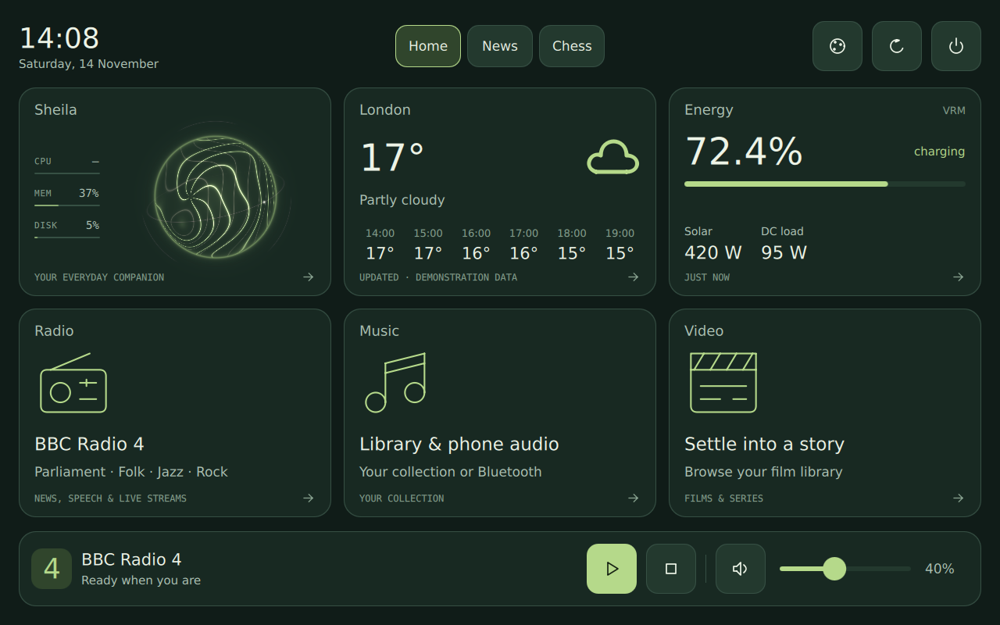
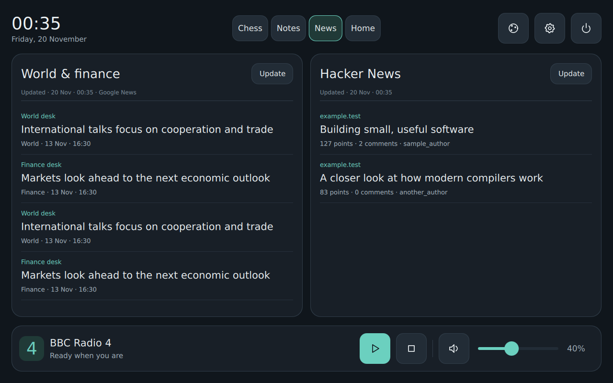

# ThinkSmart Home

A native Qt Quick dashboard for the **Lenovo ThinkSmart View**, running Debian.
Voice assistance, radio, weather, music, films, news, chess and notes—with a touch-first
interface that adapts to landscape and portrait. Choose the modules you need.



*Screenshots use demonstration data. Your Wi-Fi, accounts and API keys stay local.*

## Start with your coding agent

Clone this repository, open it in your coding agent, and paste:

```text
Help me install ThinkSmart Home on my Lenovo ThinkSmart View.
Read AGENTS.md and docs/INSTALL.md first. Check my device variant and current OS,
then ask which modules I want, my location/timezone, and how to reach the device.
Create my configuration in private/ without printing passwords or API keys.
Build using Docker on this computer. Use the existing Debian installation where
possible; if firmware installation is needed, prepare and verify it before asking
me to approve flashing. Install only the optional components I selected, preserve
this device's calibration and identities, and verify SSH, touch, audio and startup.
```

An existing Debian device with working graphics/audio is the quickest route.
For a completely custom image, [m0s4ik/thinksmart-view-debian](https://github.com/m0s4ik/thinksmart-view-debian)
is a very useful starting point: it provides the Debian base and image-building
tools used by this project, ready for your own software and interface.

**Guides:** [Install](docs/INSTALL.md) · [Configuration](docs/CONFIGURATION.md) ·
[Optional modules](docs/MODULES.md) · [Voice and audio](docs/VOICE.md) ·
[Administration](docs/ADMIN.md) · [Personal actions](docs/PERSONAL.md) · [Development](docs/DEVELOPMENT.md)

<details>
<summary>More screenshots</summary>

| Voice assistant | News and Hacker News |
| --- | --- |
|  |  |

| Chess | Portrait layout |
| --- | --- |
|  |  |

</details>

The launcher supports dark themes, screen sleep/wake and physical volume keys.
Optional integrations include OpenAI Realtime/Live, Navidrome, Jellyfin, Bluetooth
speaker mode and Victron VRM. Media uses mpv/libmpv with hardware decoding where
the device's driver and stream support it. Enabled dashboard pages form a ring.

**Licence:** our original code is [MIT](LICENSE). Imported code and artwork keep
their own licences; see [third-party notices](THIRD_PARTY.md). Linked dependencies,
including the default GPL build of libmpv, impose their own distribution terms.
No firmware image, credentials, personal recordings or personalised wake model
are included.
