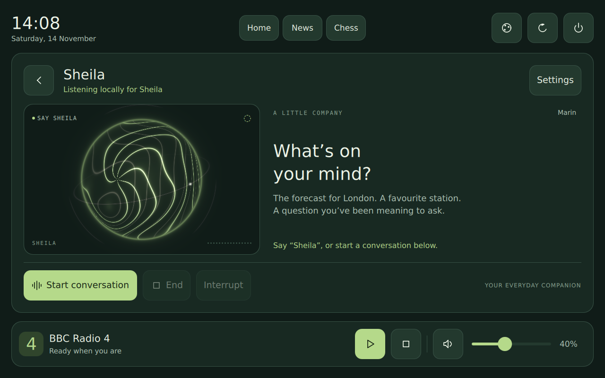
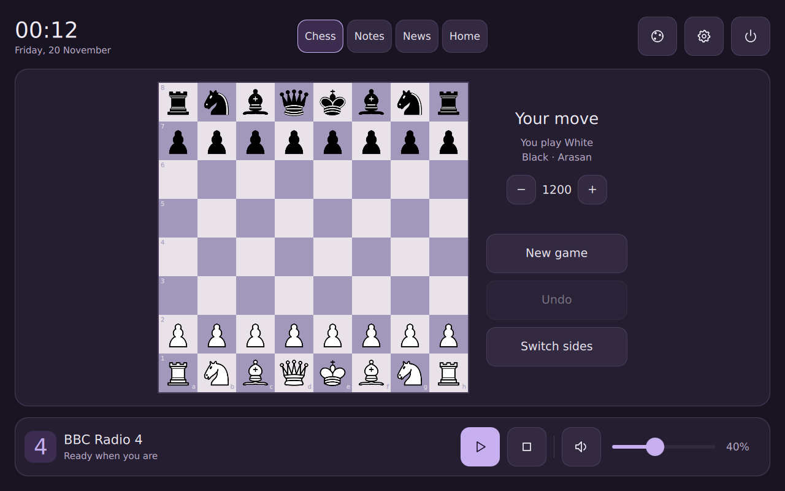
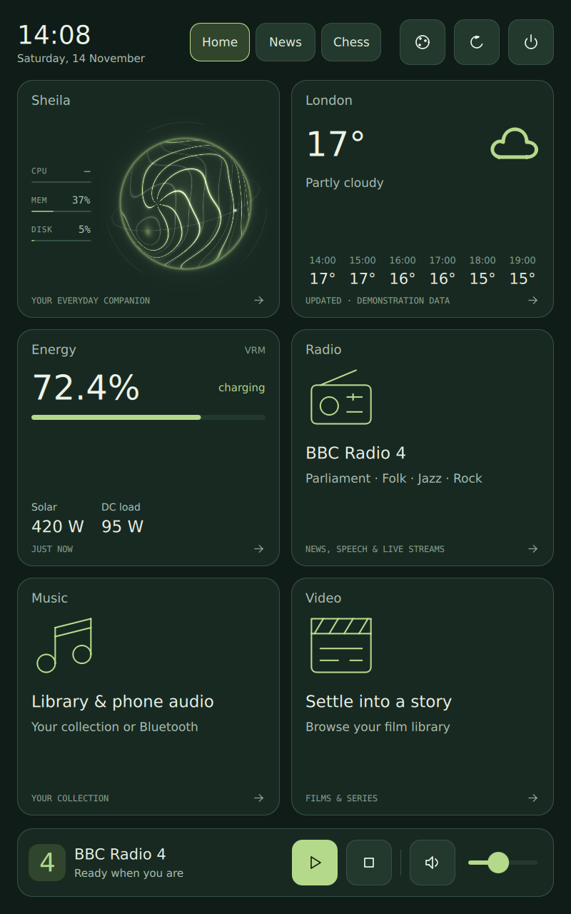
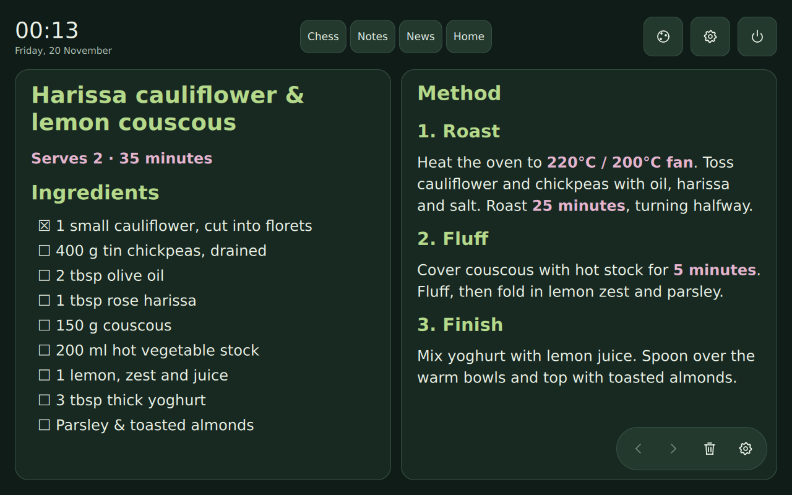
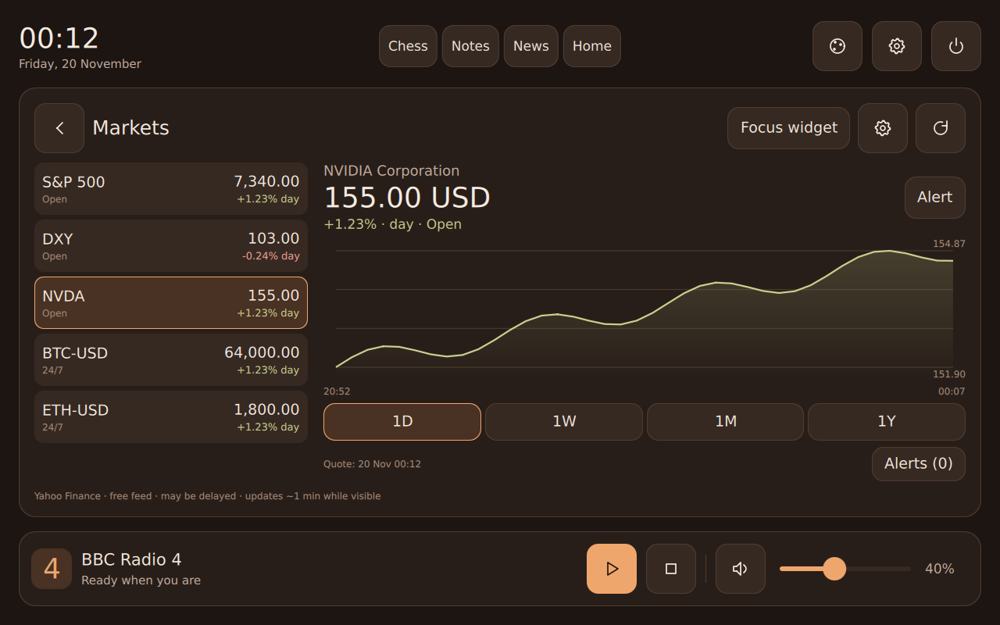

# ThinkSmart Home

Turn a **Lenovo ThinkSmart View** into a personal home dashboard running Debian
and Qt Quick. Talk to your assistant, play radio and films, check the weather and
markets, read the news or play chess—all through a native touch interface.

Choose your modules, arrange up to six widgets per page, and use the device in
landscape or portrait. A coding agent can build and customise your installation
from this repository; your accounts, prompts and household settings stay private.


*Screenshots use demonstration data.*

## Start with your coding agent

Clone this repository, open it in your coding agent, and paste:

```text
Install and customise ThinkSmart Home for my Lenovo ThinkSmart View.
Read AGENTS.md, docs/INSTALL.md, docs/CONFIGURATION.md and docs/MODULES.md.
Inspect my device and host, then help me choose modules and a page layout.
Ask for missing device/panel, OS, SSH and location/timezone details.
Keep credentials in private/ using the templates; never print secrets.
Build and test with Docker on this computer. Reuse working Debian, graphics
and audio, and install the optional dependencies only for my chosen modules.
Preserve existing pages, settings, prompts, calibration and device identities.
For stock firmware, prepare and verify the image/target before asking me to
approve flashing. Verify startup, SSH, touch, audio and screen sleep as applicable.
Do not start paid voice or microphone tests without asking. Record what you
installed and how to administer or roll it back in a private admin.md.
```

The build host can run Arch/Manjaro or another Linux distribution with Docker;
it does not need a Debian desktop. An existing Debian device with working
graphics/audio is the quickest route. See the [installation guide](docs/INSTALL.md)
for prerequisites, agent workflow and device setup.

For a completely custom image, [m0s4ik/thinksmart-view-debian](https://github.com/m0s4ik/thinksmart-view-debian)
is a very useful starting point: it provides the Debian base and image-building
tools used by this project, ready for your own software and interface.

## Modules

| Module | What it does | Setup |
| --- | --- | --- |
| [Assistant](docs/VOICE.md) | OpenAI Realtime/Live voice, local wake word, personalities and bounded learned memory | OpenAI key; optional wake-word assets |
| [Recipes / AI outputs](docs/RECIPES.md) | Recipes, ingredient checklists and saved Markdown outputs | OpenAI key for generation; saved outputs work offline |
| [Audiobooks](docs/AUDIOBOOKS.md) | LibriVox, Top 100 discovery, monthly picks and saved listening positions | Internet; no API key |
| [Radio](docs/RADIO.md) | Worldwide station search, genre browsing and saved favourites | Internet; no API key |
| [Weather](docs/WEATHER.md) | Current conditions, hourly and daily forecasts from Open-Meteo | Location; no API key |
| [Markets](docs/MARKETS.md) | Editable watchlist, focused charts, session status and price alerts | Free quotes, which may be delayed; no API key |
| [TV Archive](docs/TV-ARCHIVE.md) | Classic British series, episode browsing, resume and optional autoplay | Internet Archive; no API key |
| [TV / IPTV](docs/IPTV.md) | Internet TV directory, saved streams and fullscreen playback | Internet or your own stream links |
| [News](docs/NEWS.md) | One or two configurable feeds, publisher presets and Hacker News comments | Internet; cached reading |
| [Chess](docs/MODULES.md) | Theme-aware board, adjustable engine strength and either playing side | Local Arasan engine |
| [Notes](docs/PERSONAL.md) | Saved notes, touch deletion and optional voice dictation | Local storage; Assistant for dictation |
| [Bluetooth speaker](docs/MODULES.md) | Play audio from your phone through the device | BlueZ and BlueALSA |
| [Music / Navidrome](docs/MUSIC.md) | Browse, queue and ask the assistant to play your music library | Navidrome server and credentials |
| [Video / Jellyfin](docs/MODULES.md) | Native film browsing by category/decade, posters and fullscreen playback | Jellyfin server and credentials |
| [Energy / Victron VRM](docs/MODULES.md) | Battery, solar and energy readings, including cached offline data | VRM installation and read-only token |

Use **Settings → Pages & modules → Add application** for guided setup; use
**Placement** to move active apps between widgets, full pages or opening on request. One page can hold several modules; new widgets can go on an
existing page. Disabling a module stops its background activity and removes its
related AI capabilities. It remains part of the shared application binary.
See [module setup and dependencies](docs/MODULES.md).

The dashboard also includes editable dark themes, screen sleep/wake, physical
volume controls, [Wi-Fi settings and a touch keyboard](docs/WIFI.md). The
assistant can manage [notes, themes, routines, timers and scheduled actions](docs/PERSONAL.md).
Video uses mpv/libmpv with [hardware decoding where supported](docs/VIDEO-COMPATIBILITY.md).

## Customise and extend

Arrange your device through the touch UI, edit prompts and configuration over
SSH, or ask a coding agent to add an integration. New modules are native Qt
components compiled into the app, with their own optional AI instructions and
actions. The [module development guide](docs/MODULE-DEVELOPMENT.md) includes a
starting prompt and contribution workflow.

[Configuration](docs/CONFIGURATION.md) · [Pages and widgets](docs/PAGES-AND-MODULES.md) ·
[Administration](docs/ADMIN.md) · [Development and tests](docs/DEVELOPMENT.md)

## Screenshots

| Voice assistant | News and Hacker News · Tide theme |
| --- | --- |
|  |  |

| Chess · Dusk theme | Portrait layout |
| --- | --- |
|  |  |

| Recipes | Markets · Autumn theme |
| --- | --- |
|  |  |

**Licence:** our original code is [MIT](LICENSE). Imported code and artwork keep
their own licences; see [third-party notices](THIRD_PARTY.md). Linked dependencies,
including the default GPL build of libmpv, impose their own distribution terms.
No firmware image, credentials, personal recordings or personalised wake model
are included.
