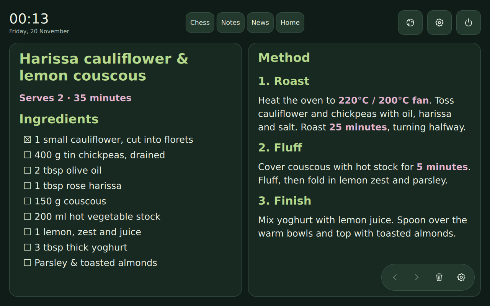

# Recipes and written AI outputs

Recipes demonstrates voice delegation to a text model, with useful native
documents retained after the conversation ends. It is optional and disabled by
default. Enable **Recipes** in **Settings → Pages & modules** and put its widget
on an existing widget page, or choose a full-page view. Disabling it retains
saved data and removes its AI tools/instructions; it makes no background API
requests. Runtime disabling does not remove compiled code.



## Reader and settings

Ask Sheila: “Put a lentil soup recipe for four on screen, in metric quantities.”
The selected text model prepares ingredients/servings/timings in the left pane
and a method in the right. Portrait stacks the panes. Each scrolls independently.
Tap an ingredient's checkbox to check/uncheck it; selections survive restarts.
Drag to scroll. Qt's native Markdown renderer supports headings, emphasis, lists
and task lists. No browser or additional rendering library is needed; HTML and
image loading are disabled in the reader.

The recipe title scrolls inside the first pane at 1.55 times the base font size.
Markdown headings use the theme accent and an explicit size hierarchy, including
smaller `###` headings; bold emphasis uses the secondary theme colour. Paragraphs
and section headings have extra spacing. These are display styles: checkbox
edits preserve plain Markdown without adding font/colour markup to saved output.
Opening the reader keeps an ongoing voice acknowledgement/conversation alive;
normal quiet timeout, screen sleep and “go to sleep” still end voice.

The toolbar floats as a compact island over the bottom-right of the output,
with **older**, **newer**, **delete** and **settings**. Text has extra scroll
clearance so the toolbar cannot trap the final lines underneath it. Deletion asks
for confirmation. Up to 32 outputs are retained, newest first. When full, delete
an unwanted output before generating another. Revisions create new outputs,
keeping the original. Failed requests keep saved outputs intact. The normal
page tabs remain available; voice and media strips do not occupy the reader.

Settings choose a base font size (18–36 px), text model and **Recipes** or
**General text** mode. Settings are also available at **Pages & modules →
Recipes → Edit** once enabled/applied. Model selection is independent
of voice: default GPT-6 Luna, with GPT-6 Sol also offered, matching the existing
Live backend choices. Availability/charges depend on your account. Set a custom
model ID over SSH in the settings file to include it in the dropdown.

## Generation and tools

Only an explicit `recipes.compose` action starts a paid text request. Opening
the page, enabling the module, changing settings and browsing history do not.
The key comes from the existing private, mode-600 OpenAI `voice.json`; no extra
key file is needed. Recipes can also be used from local tools with voice off.

Realtime and GPT Live both expose the `recipe_action` function:

| Action | Arguments / behaviour |
| --- | --- |
| `recipes.compose` | `request`: full request, servings and relevant preferences; optional saved `id` to revise. Starts the selected model. |
| `recipes.show` | `title`, `left`, `right`: display already-written Markdown without another model call; either pane can be empty. |
| `recipes.list` | Saved IDs and titles. |
| `recipes.get` | Current output or optional `id`; reports an active generation job. |
| `recipes.delete` | Delete current output or optional `id`. |

For a new recipe, Sheila submits the short composition request before speaking
an acknowledgement. `recipes.show` is reserved for existing text, keeping the
voice response from drafting a long recipe in its own tool arguments.
Composition immediately returns `accepted: true`, `status: generating` and a
job/output ID. Sheila gives a short acknowledgement, not a second spoken recipe
or a premature completion claim. The reader shows Preparing and receives the
result even if voice has ended. `recipes.get` checks progress/results. Saved
Markdown is reference data, never executable instructions. A revision sends the
selected previous output and explicit request, not the whole history or household
file. Relevant dietary preferences can be included by the voice assistant.

The Qt network client uses OpenAI's Responses API, `store: false` and a strict
JSON schema for `title`, `left` and `right`. Each composition makes one request,
with no polling or automatic paid retry. Size limits and a 90-second deadline
bound failures. Invalid, refused or incomplete results are not saved. Content,
credentials and upstream error bodies are not logged; errors show a generic
message and HTTP status when available. Development tests use local fixtures.

## Files and administration

| Standard device path | Purpose |
| --- | --- |
| `/var/lib/thinksmart-home/.config/ThinkSmart/Home/recipes.json` | Font, model, purpose; created when settings change |
| `/var/lib/thinksmart-home/.local/share/ThinkSmart/Home/recipes/history.json` | Outputs and checked task state; created on first output |
| `/etc/thinksmart/recipes/system.md` | Optional additional generator instructions; read per request, limit 16 KiB |
| `/etc/thinksmart/assistant/modules/recipes/{realtime,live,backend}.md` | Voice guidance overrides; packaged defaults apply when absent |

Settings example (no key):

```json
{"version":1,"fontSize":24,"model":"gpt-6-luna","purpose":"recipe"}
```

History is versioned UTF-8 JSON. Entries contain an ID, title, creation time and
two Markdown strings. Files use atomic writes and mode 600. Generation saves once
after completion; there are no per-token disk writes. Task toggles and settings
changes are deliberate saved edits; navigation stays in RAM. Stop the dashboard
before editing these files over SSH. Preserve them on upgrades.

Environment overrides: `THINKSMART_RECIPES_FILE`, `THINKSMART_RECIPES_CONFIG`,
`THINKSMART_RECIPES_PROMPT`; the key path follows `THINKSMART_VOICE_CONFIG`.
Production uses a fixed HTTPS OpenAI endpoint; test endpoint overrides are
compiled into test targets only.

## Adapt it to other uses

Choose **General text** for a general AI text box. The main document goes in
`left`; `right` holds an optional second section. A blank second pane gives the
first the full width. History, Markdown and task-list controls work unchanged.

To specialise it for gardening, packing lists or another task:

1. Select General text and create `/etc/thinksmart/recipes/system.md` with short
   additional writing instructions. These supplement the selected mode's built-in
   guidance. For example: “Write a seasonal garden plan. Put supplies and a task
   checklist in left, explanations and timing in right. Use UK seasons and metric
   measurements; ask for missing location details.”
2. Adapt the module's three voice prompt overrides to explain when to compose
   versus display existing text. Preserve unrelated personalities/household files.
   Voice guidance reloads each conversation.
3. For a public module variant, change catalogue ID/title/action prefix, widget
   copy and docs following [Module development](MODULE-DEVELOPMENT.md). Retain
   module guards and the shared native Markdown reader.

## Checks

`recipes-tests` covers explicit-only requests, structured output, revision
context, settings/history persistence, failures, incomplete replies and
disabled/corrupt state using a local HTTP fixture.
`recipesReaderHistorySettingsAndTouchTasks` covers orientation, real checkbox
taps, navigation, deletion and font settings; `recipesVoiceTools` checks mocked
Realtime and Live paths. No real microphone or paid-generation tests are needed.
